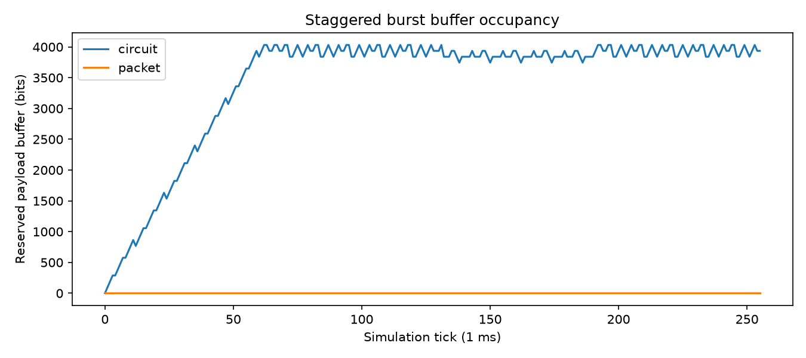

# 实验一 电路交换与分组交换的资源利用率比较

姓名：陈吉冠  学号：2024271043

实验日期：2026-10-19。GitHub 账号：[qq4861261413-code](https://github.com/qq4861261413-code)。教师模板基线提交：`bc9099e3f932168af640ce0d03abc2c3f283e10f`。

## 实验目的

在相同的到达序列、线路容量、缓存配额和观察窗口下，比较固定时隙电路交换与共享 FIFO 分组交换。分别观察完整交付的有效载荷、线路实际发送量、完成时延、丢失和积压。实验结果表明，统计复用能改善热点和轻载业务的等待，但包头开销及观察窗口会改变比较结论，不能认为某种方式始终更优。

## 原理和模型

默认配置为 4 用户、256 tick、每 tick 1 ms、128 bit 发送预算、32 bit 分组包头、4096 bit 总有效载荷缓存，随机种子为 2026。总观察容量为 `256 × 128 = 32768 bit`，对应抽象链路速率 128 kbit/s，不能再乘用户数。

电路交换在 tick 开始时确定服务用户 `tick % users`，只处理该用户 FIFO。即使该用户没有数据，其他用户也不能借用该时隙。分组交换使用全用户共享 FIFO，记录的 `remaining_wire_bits` 已在准入时初始化为 `payload_bits + header_bits`；发送函数不重复加头。同 tick 到达保持输入顺序，先发完队首再处理下一条，两种方式都允许一个 tick 完成多条短记录，或将长记录留到后续 tick 续传。

到达准入先于当 tick 发送。两模型都按所有未完成记录的原始 payload 总和预留缓存，包含正在发送的记录；只有完整交付才释放整条预留。放不下的新记录整条尾丢弃。包头占线路容量，不占本课堂模型的 payload 缓存。

记录在 tick 结束边界交付，完成时延为 `(tick + 1 - arrival_tick) × tick_ms`。窗口截至 tick 255 的发送结束边界，不继续排空；最后一个 tick 内完成的记录计入交付，其余未完成记录计积压。

指标口径如下：有效载荷利用率为完整交付 payload 除以总线路容量；线路忙碌率为实际发送 wire 除以总容量，包含包头和未完成记录已发送的部分；时延按已完成记录逐条平均，不按 payload 加权；丢失率按丢弃 payload 占生成 payload 计算。没有完成记录时两个时延指标均为 `None`，没有生成数据时丢失率为 0。

每组结果检查 `generated_payload_bits = delivered_payload_bits + dropped_payload_bits + backlog_payload_bits`。部分发送的记录仍以全部原始 payload 计积压，不能把已发片段重复算成完整交付。

PCM 工具是独立教学示例：32 时隙 × 8 bit × 8000 帧/s = 2.048 Mbit/s，保留 TS0、TS16。它与 128 kbit/s 的比较链路不是同一个速率模型。

## 手工推演与程序核对

我根据题目给定条件完成了下面两用户例子的手算，确认了每个时隙的发送情况、完成时刻和指标计算，并与程序结果核对。该例最初由 AI 助手协助讲解，我随后复算并确认理解；代码实现前的初始推演及测试仍如实记入 AI_LOG.md。

设 2 用户、2 tick、每 tick 1 ms、容量 128 bit、包头 32 bit、缓存足够，只有 tick 0 用户 1 到达一条 96 bit 记录。

| tick | 电路服务和完成情况 | 分组服务和完成情况 |
|---|---|---|
| 0 | 服务用户 0，队列空，发送 0 | 发送用户 1 的 96 + 32 = 128 bit，在 1 ms 完成 |
| 1 | 服务用户 1，发送 96 bit，在 2 ms 完成 | 队列已空，发送 0 |

总容量为 256 bit。两者有效载荷利用率均为 `96/256 = 37.5%`；电路线路忙碌率为 37.5%，分组为 `128/256 = 50%`。电路平均和最大时延均为 2 ms，分组均为 1 ms；丢失与积压都为 0。`test_two_user_hand_calculation` 对两模型验证了以上预期。

相同有效载荷利用率不代表相同时延；较高线路忙碌率也不必然代表交付更多有效载荷。

## 默认配置的实验结果

以下来自本项目实现实际生成的 `results/comparison.csv`，百分比和时延为显示时四舍五入；原始文件保留完整精度。

| 业务 | 模型 | 有效载荷利用率 | 线路忙碌率 | 平均时延 ms | 最大时延 ms | 丢失率 | 积压 bit |
|---|---|---:|---:|---:|---:|---:|---:|
| continuous | circuit | 100.000% | 100.000% | 2.500 | 4 | 0.000% | 0 |
| continuous | packet | 79.688% | 100.000% | 26.147 | 40 | 8.984% | 3712 |
| staggered_burst | circuit | 49.219% | 49.512% | 45.095 | 127 | 18.359% | 3936 |
| staggered_burst | packet | 75.000% | 100.000% | 1.000 | 1 | 0.000% | 0 |
| synchronized_burst | circuit | 33.984% | 34.375% | 12.707 | 24 | 0.000% | 1152 |
| synchronized_burst | packet | 32.813% | 43.750% | 15.357 | 32 | 0.000% | 1536 |
| light_random | circuit | 21.094% | 21.094% | 3.111 | 10 | 0.000% | 0 |
| light_random | packet | 21.094% | 28.125% | 1.097 | 2 | 0.000% | 0 |





连续业务每 4 tick 生成 4 条 128 bit 记录，恰好填满电路的四个固定时隙。分组每条多 32 bit，输入的线路需求超过链路容量，所以虽然线路同样忙满，完整交付仅 26112 bit，而电路交付 32768 bit。分组还丢弃 2944 bit、积压 3712 bit，满足 `32768 = 26112 + 2944 + 3712`。这里包头代价压过共享资源的收益。

错峰突发每 tick 到达一条 96 bit，热点用户每 64 tick 切换。电路在热点期间不能借用其他用户的时隙，后续虽然能继续清理旧热点队列，仍出现长等待和溢出：生成 24576 bit，交付 16128 bit，丢弃 4512 bit，积压 3936 bit。分组每条含头正好 128 bit，每 tick 都能完成新到记录，交付全部 24576 bit，无丢失和积压，平均时延为 1 ms。

同步突发在 tick 0、80、160、240 各到达 32 条 96 bit 记录。一波电路可在 24 tick 内完成，带头分组需 32 tick。最后一波只有 16 tick 可发送：电路完成 20 条，分组完成 16 条；加上前三波，总交付分别为 11136 bit 和 10752 bit，积压分别为 1152 bit 和 1536 bit。两者均无丢失。这个场景中，分组线路忙碌率更高，却交付更少、平均完成时延更高，不能把发送包头的时间直接当作有效收益。

轻载随机业务共生成并交付 6912 bit，两模型都没有丢失和积压，有效载荷利用率相同。分组通常无需等待固定用户时隙，平均时延从 3.111 ms 降至 1.097 ms；与此同时，包头使线路忙碌率从 21.094% 升至 28.125%。因此同一场景的时延收益与线路开销应分别解释。

## 独立边界测试

`student_tests/test_my_case.py` 含 7 个参数化展开后的用例，由 AI 助手协助设计，均已运行通过。

主要独立反例检查跨 tick 缓存预留：1 用户、2 tick、缓存 200 bit，tick 0 到达 payload 160，tick 1 到达 payload 80。第一 tick 电路发送 128 bit、分组发送 128 bit，但原始 160 bit 必须继续全额预留。第二 tick 准入时 `160 + 80 > 200`，因此新记录整条丢弃；之后第一条才完整交付。两模型都应生成 240、交付 160、丢弃 80、积压 0，平均和最大时延均为 2 ms，丢失率为 1/3；电路总 wire 为 160，分组为 192。断言核对第一 tick 缓存仍为 160、第二条丢弃、完成条数为 1 等。该反例能发现按已发片段提前释放缓存、以及先服务再准入的错误。

另一个边界是 1 tick 内发送 payload 200、header 32 的分组：wire 初值 232，发出 128 后余 104，不存在完整交付。预期生成 200、交付 0、丢弃 0、积压 200，线路忙碌率 100%，有效载荷利用率 0，两个时延指标均为 `None`。它能识别部分发送误计交付、积压少计和用 0 掩盖无样本。

其余用例核对两用户手算、最后 tick 结束边界交付计入窗口，以及非整数 `tick_ms=0.5` 时的毫秒转换。

## 包头参数变化分析

使用 `student_tests/run_parameter_experiment.py` 将 `header_bits` 从 32 改为 0；其余配置、四类业务生成规则及种子 2026 均保持一致。附加 8 组结果单独保存在 `results/extra/header_bits_0.json` 和 `header_bits_0.csv`，没有覆盖基线。

电路不使用分组包头参数，四种业务的全部原始统计量和轨迹与基线逐项相同。分组变化如下。

| 分组业务 | 有效载荷利用率 32→0 bit | 线路忙碌率 32→0 bit | 平均时延 ms 32→0 bit | 丢失率 32→0 bit | 积压 bit 32→0 bit |
|---|---|---|---|---|---|
| continuous | 79.688% → 100.000% | 100.000% → 100.000% | 26.147 → 2.500 | 8.984% → 0.000% | 3712 → 0 |
| staggered_burst | 75.000% → 75.000% | 100.000% → 75.000% | 1.000 → 1.000 | 0.000% → 0.000% | 0 → 0 |
| synchronized_burst | 32.813% → 34.277% | 43.750% → 34.375% | 15.357 → 12.009 | 0.000% → 0.000% | 1536 → 1056 |
| light_random | 21.094% → 21.094% | 28.125% → 21.094% | 1.097 → 1.097 | 0.000% → 0.000% | 0 → 0 |

去掉包头后，连续业务不再过载，分组与电路都交付全部 payload。错峰和轻载的记录原本通常已能在一个 tick 完成，去头后虽然 wire 减少，完成边界并未提前，所以平均时延不一定下降。

无头同步突发中，分组比电路多完整交付 96 bit，但两者 wire 同为 11264 bit。原因是末尾 16 tick 内，共享队列用 2048 bit 容量完成 21 条 96 bit 记录；电路的每个用户只分到 512 bit，各完成 5 条，共 20 条，各队首残余发送不能合并成完整交付。分组仍有一条部分发送记录，因此无包头时有效载荷利用率也可能低于线路忙碌率。这是有限窗口和完整记录计量的共同结果。

## 验证与复现

本次使用 Windows、Python 3.13.1 和项目独立 `.venv`；满足教师 Python 3.10 及以上要求，未另装建议的 3.12。依赖遵循原 `requirements.txt`：NumPy 2.5.4、Matplotlib 3.11.2、pytest 9.1.1。未修改教师测试、评分脚本、仿真框架或工作流。

在项目根目录执行：

```powershell
.\.venv\Scripts\python.exe src/test_environment.py
.\.venv\Scripts\python.exe -m pytest grading/test_framework.py -q
.\.venv\Scripts\python.exe -m pytest grading/test_circuit.py -q
.\.venv\Scripts\python.exe -m pytest grading/test_packet.py -q
.\.venv\Scripts\python.exe -m pytest grading/test_metrics.py -q
.\.venv\Scripts\python.exe src/performance_test.py
.\.venv\Scripts\python.exe -m pytest grading/test_integration.py -q
.\.venv\Scripts\python.exe -m pytest student_tests -q
.\.venv\Scripts\python.exe student_tests/run_parameter_experiment.py
.\.venv\Scripts\python.exe grading/calculate_grade.py
```

环境检查通过，框架 4 项、电路 4 项、分组 4 项、指标 3 项、集成 3 项、学生边界 7 项均通过。默认仿真运行两次，JSON、CSV、三张 PNG 的 SHA-256 分别完全一致。基线和附加实验均检查 8 行指标、8 组轨迹及 payload 守恒。实际本地评分为自动项 70/70，状态为 ok；评分文件中的 70/100 不包含待评的教师人工 30 分，不是最终成绩。

Matplotlib 在沙箱内报告字体缓存无法写入用户缓存目录，但三张图实际生成成功、可打开；未因此更改系统权限或教师绘图代码。

## 分析与限制

统计复用在用户负载不均、空时隙较多时有优势，连续满载下则可能主要体现包头代价。平均时延只反映已完成的记录，必须结合交付量、丢失和积压阅读。积压表示窗口结束时尚未完成，不等同于尾丢弃。

本实验未模拟建立连接、传播、误码、重传、多跳路由或真实设备缓存，因此不据此评价真实互联网与电信网络的总体优劣。输入同刻顺序影响共享 FIFO 的用户间等待，本文没有据此宣称公平性。256 ms 有限窗口的结果也不能直接当作长期稳态结论。

## AI 使用说明与提交状态

AI 助手负责本地环境准备、三个函数的逐项实现、先验计算、测试设计、实际运行、结果核对及本报告草稿。另由只读子代理独立复核模型预期，未读取或复制教师参考结果。详细协作过程见 [AI_LOG.md](AI_LOG.md)。

本人已完成本节两用户例子的手算，并确认理解 37.5% 有效载荷利用率、37.5% 与 50% 线路忙碌率，以及 2 ms 与 1 ms 完成时延的计算和差异。其他边界用例与核心发送循环的解释需要另行核对，不将本次手算确认扩展为全部代码理解已完成。本文记录本地验证结果，正式提交及线上自动评分以教师仓库 PR 对应的最新 commit 为准。自动项满额也只表示 70 分自动部分，教师人工 30 分与最终成绩待评。

## 参考资料

1. 教师《实验一 PRD 电路交换与分组交换》V1.2，2026-10-18。
2. [课程仓库](https://github.com/jwentong/modern-switching-experiment-01) 的 `README.md` 与 `docs/model_contract.md`，基线 bc9099e。
3. 本项目 `src/models.py`、`src/utils.py`、三个任务函数 docstring，以及公开 `grading` 测试与评分脚本。
